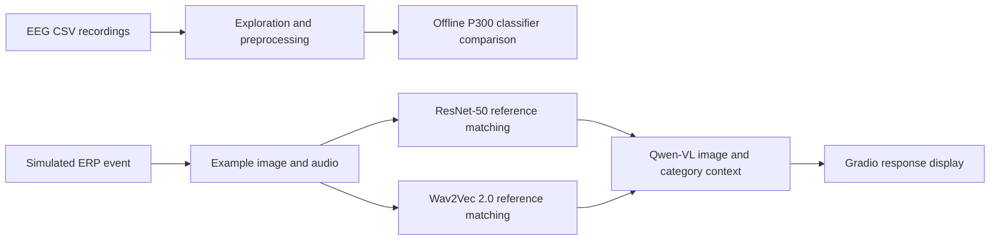

# ERP-Based Integrated Assistive Brain-Computer Interface

Research code for a bachelor's thesis proof of concept combining offline EEG/P300 classification with a multimodal assistive interface.

The code has two related components:

1. **EEG analysis:** explore an existing EEG dataset, preprocess and epoch recordings, and compare Support Vector Machine, Random Forest and Minimum Distance to Mean classifiers for P300 detection.
2. **Audiovisual assistance:** compare example audio and images with reference categories, send the selected image and category labels to a Qwen-VL endpoint, and display its response in a Gradio interface.

The Gradio demo simulates an ERP event with a button press. EEG classification runs separately in the notebooks. The example scenario is driving-related situational assistance; this is an experimental demonstration, with no claim of clinical or road-use validation.

## Interface preview

[](assets/interface-preview.png)

*The original prototype, shown in the thesis (Figure 8). The server-configuration row has been cropped out to remove the saved tunnel address. Select the image to view it at full resolution.*

## Workflow



## Files

| File | Purpose |
| --- | --- |
| [Data_Exploration.ipynb](Data_Exploration.ipynb) | EEG inspection, filtering, ERP visualization and class-imbalance exploration. |
| [p300_classifiers.ipynb](p300_classifiers.ipynb) | SVM, Random Forest and MDM experiments, with train/validation/holdout splits, cross-validation and preprocessing variants. |
| [ultimate_wav2vec.py](ultimate_wav2vec.py) | Audio loading, mono conversion/resampling, mean-pooled Wav2Vec 2.0 representations and cosine-similarity reference matching. |
| [ultimate_image_classification.py](ultimate_image_classification.py) | Image preprocessing and cosine-similarity matching of pretrained ResNet-50 output vectors against category references. |
| [classifiers_evaluation.ipynb](classifiers_evaluation.ipynb) | Evaluation of audio/image matching through classification reports and confusion matrices. |
| [qwen_vl.ipynb](qwen_vl.ipynb) | Legacy Colab/GPU setup for a Qwen-VL-Chat-Int4 FastAPI endpoint and optional ngrok tunnel. |
| [ultimate_connect.py](ultimate_connect.py) | Example selection, model calls, HTTP integration and Gradio demo. |
| [project_config.py](project_config.py) | Data-directory and backend-URL configuration through environment variables. |
| [requirements.txt](requirements.txt) | Dependency inventory for the notebooks and local demo. |

The original one-page PDF description is retained as a historical project note. This README contains the current setup and privacy notes.

## Data layout

Datasets, reference media and model checkpoints are not included in this source copy. Supply data you are authorized to use locally:

```text
data/
├── eeg/
│   ├── Header.csv
│   ├── subject_02_csv/
│   │   ├── subject_02_session_01.csv
│   │   ├── subject_02_session_02.csv
│   │   └── subject_02_session_03.csv
│   └── ...
├── audios_categories/
│   └── <category>_<number>.wav
├── image_categories/
│   ├── ambulance_category/
│   ├── unexpected_pedestrian_category/
│   ├── dashboard_warning_category/
│   └── nothing_category/
└── examples/
    └── <example_folder>/
        ├── <category>_input_<number>.jpeg
        └── <category>_input_<number>.wav
```

The EEG notebooks retain the public dataset's anonymous subject/session naming and existing experiment selections. Obtain the dataset and its preprocessing context through the [original dataset repository](https://github.com/plcrodrigues/py.BI.EEG.2015a-GIPSA). Point `BCI_EEG_DATA_DIR` at the directory containing `Header.csv` and the subject folders.

The audio matcher uses the filenames of reference WAV files as labels. The evaluation notebook derives expected labels from input filenames by removing numeric suffixes, `_input_` markers and extensions. Keep the original category/file naming conventions consistent when preparing examples. Each selected demo example folder needs both a `.jpeg` image and a `.wav` audio file.

## Local environment

The original analysis notebooks record Python 3.10.6. A complete historical environment lockfile was not supplied; `requirements.txt` records the imports used by this code and does not guarantee exact reproduction of the original package versions.

From this directory, prepare an environment and install the dependencies:

```sh
python3.10 -m venv .venv
source .venv/bin/activate
python -m pip install -r requirements.txt
```

Use environment variables for local configuration:

```sh
export BCI_DATA_DIR="$PWD/data"
export BCI_EEG_DATA_DIR="$BCI_DATA_DIR/eeg"
export BCI_BACKEND_URL="http://127.0.0.1:8000"
```

These variables are optional when using the default `data/` layout and a model endpoint on local port 8000. Pretrained model initialization downloads model files if they are not already cached.

### EEG notebooks

Launch Jupyter from this directory so the notebooks can import `project_config.py`:

```sh
python -m jupyterlab
```

Run `Data_Exploration.ipynb` for exploratory analysis and `p300_classifiers.ipynb` for the classifier experiments. The latter contains alternative experiments; inspect the Markdown headings and run the variants relevant to your analysis. Experiment selections, preprocessing settings and model comparisons have been preserved.

### Audiovisual demo

1. Prepare the reference media and example folders above.
2. Start the model endpoint from `qwen_vl.ipynb` in a separate compatible GPU/Colab environment. Its installation cells retain the original Transformers 4.32.0 / GPTQ setup and upstream installation references. They are historical setup instructions, rather than a verified current GPU environment.
3. If using Colab's optional ngrok bridge, supply `NGROK_AUTHTOKEN` through an environment variable or a Colab secret of the same name. No token is embedded in the notebook. The runtime URL is printed when the bridge starts; do not save it in a distributed notebook.
4. Run the local interface:

```sh
python ultimate_connect.py
```

Enter the model API base URL in the interface. The client sends a multipart request to `/uploadfile/` containing the selected image plus `aud` and `img` category fields. Qwen-VL uses the image and textual category context to generate the response. Uploaded images are held in a temporary directory that is cleaned after the request.

Run `classifiers_evaluation.ipynb` separately to evaluate audio/image reference matching.

## Scope and reproducibility

- Audio/image matching uses pretrained representations and cosine similarity; the supplied scripts do not train new audio or image classifiers.
- The EEG experiments and interface are separate research components. The interface's button represents a simulated ERP event.
- No new numerical results are asserted in this README. Saved notebook outputs have been removed from this copy.
- End-to-end training and inference require the omitted datasets, media, model downloads and a compatible GPU backend. The anonymized export has been checked structurally and syntactically; those full experiments have not been rerun.
- The local interface retains the original Gradio API style. Its original package versions were not fully pinned.

## Privacy and source credits

This copy uses configurable paths and generic configuration names. Notebook outputs, execution counts, embedded widget state and identifying execution metadata have been cleared. Personal paths, saved tunnel addresses and filesystem-origin metadata have been removed. `.gitignore` excludes local data, credentials, environment files, caches, model artifacts and generated outputs.

The interface preview is a cropped extraction of the historical thesis screenshot, rather than a new model run. Its original example input and generated response are unchanged; the server address and surrounding interface chrome are excluded. The PNG contains no embedded source-document metadata.

Before sharing notebooks after running experiments, clear their outputs again and review any newly added data or configuration. Credentials should stay in environment variables or the runtime secret store.

Original tutorial, dataset and upstream-code credits remain in the notebooks and source comments. Core references include the [EEG dataset/preprocessing repository](https://github.com/plcrodrigues/py.BI.EEG.2015a-GIPSA), [Qwen-VL](https://github.com/QwenLM/Qwen-VL), [Wav2Vec 2.0 documentation](https://huggingface.co/docs/transformers/en/model_doc/wav2vec2), and the source links retained beside adapted code. No new license or ownership claim has been added.
